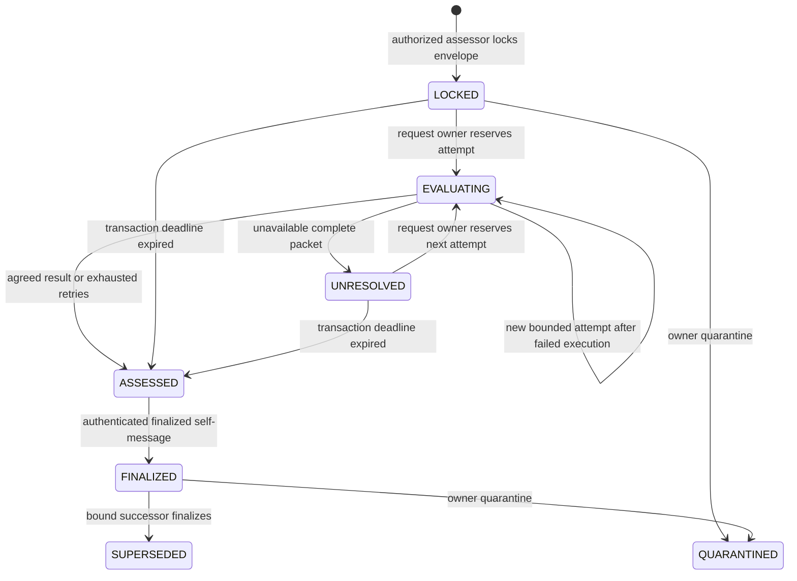
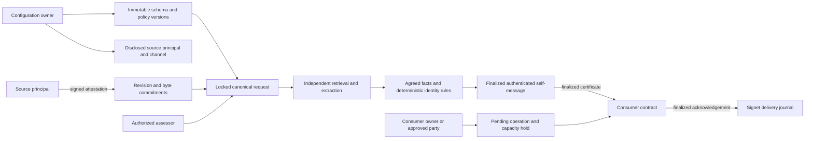

# Authority, lifecycle and identity safety

## Authority boundary

The deployment signer owns configuration. It may grant assessment permission, register immutable schema and policy versions, disclose source authority configurations, and quarantine policies, authorities, source revisions, consumers or relations. It cannot edit a locked request, change an attested revision, forge a source principal's signature, approve another consumer's configuration, or release somebody else's hold.

Only a configured principal can attest a source in that principal's approved HTTPS channel. Each subject ID belongs to the principal that first attests it. Assessment permission grants no source, consumer or reservation authority. The resolver owner must admit the consumer, and configuration registration must arrive from that consumer contract address; its own owner triggers the finalized registration message.

Source trust is explicit delegation by the resolver owner. It does not establish that a principal owns every publisher, that a document is universally true, or that the originator is authentic beyond this configuration. Public evidence discloses the delegated provenance. Validators retrieve the committed bytes independently and verify required span commitments. They inspect the complete packet for contrary facts and controlling exceptions. Instructions embedded in a source have no policy authority.

The supported schemas cover public organizational, incident and obligation identity. Personal identity and biometric matching are outside this deployment's boundary. All transaction arguments and on-chain history are public. Source text is retrieved during assessment; only commitments, normalized facts and citation locators persist.

## State and authority diagram

LOCKED, EVALUATING, UNRESOLVED and ASSESSED are not consequence-bearing finality states. A failed semantic transaction leaves its previously reserved attempt consumed. Three attempts are permitted for a locked source revision. Scheduling after three failed executions exposes a canonical UNKNOWN result with `RETRY_EXHAUSTED`. A source outage remains unavailable and never creates an affirmative fact or an absence certificate.

FINALIZED means the authenticated self-message emitted on GenLayer transaction finalization has executed. The decision inside that state may be SAME, DISTINCT or UNKNOWN. Deadline exhaustion has an UNKNOWN vector with `DEADLINE_EXPIRED`, delivered through the same finality barrier. SUPERSEDED and QUARANTINED retain their envelope, result and historical references. An unavailable message scheduler leaves the request pending rather than manufacturing finality. The request owner may call `evaluate()` on ASSESSED to reschedule its finalized confirmation after a 60-second interval, with at most three confirmation submissions.

## Identity kernel

Every supported mandatory discriminator must be present and match before SAME is possible. A known discriminator conflict establishes DISTINCT. `scope_ambiguous` blocks an affirmative relation. `related_only` and `controlling_exception` establish DISTINCT with their controlling witness. Missing mandatory facts produce UNKNOWN.

For an obligation, the fields are payer ID, payee ID, consideration, period, integer amount in minor units and currency. Invoice numbers do not independently control identity. A reissued invoice number can still denote the same obligation. A different monthly period or a separately enforceable obligation is distinct.

For an incident, event date, location ID, event kind and occurrence ID identify the particular occurrence. Display names do not control identity. A renamed record can be the same occurrence; a recurring incident on another date is distinct.

For an organization, official ID and jurisdiction control identity. Matching names with different official IDs are distinct. Names alone cannot support the mandatory fields.

The semantic extractor returns facts, flags and witnesses. The deterministic kernel computes the relation. Validators derive those facts independently and compare the material vector, rather than accepting a leader's JSON label. Official identifier spelling and case are preserved. Semantic descriptions use whitespace and case normalization; dates and quantities retain their identifying meaning. Authoritative decision fields require exact nested types and are deterministically reconstructed after consensus. Descriptive translations must independently yield the same normalized fact. Disagreement is a consensus failure, not permission to merge.

Witnesses identify raw SHA-256 source bytes and their half-open UTF-8 line spans. Each participant extracts adequate supporting span sets. A leader's selected witness must belong to the validator's independently supported set for that same fact and side. Canonical selection uses the lowest lexical ID within the leader's adequate set. This admits equivalent independently supported witness sets without comparing arbitrary prose or requiring arbitrary set equality. Unsupported, missing, hallucinated or wrong-side witnesses fail validation.

## Alias safety and revisions

Clusters contain at most four historical IDs. Before joining clusters, the resolver checks at most sixteen cross-pair indexes. Every cross-pair must have an active finalized SAME witness under the same policy version, scope and discriminator fingerprint. Every cluster edge is bound to its exact finalized witness and must remain active with the recorded policy, scope and discriminator fingerprint. Replacing a pair witness cannot silently change an existing cluster. Known DISTINCT witnesses persist across policy revisions, quarantine and UNKNOWN successors. Each pair admits at most sixteen historical DISTINCT witnesses during alias registration; above that bound registration returns unresolved. An explicitly bound, active SAME successor can correct its exact negative witness, while every other active negative witness retains its veto. Correction dependencies remain conditional on a current valid SAME ruling; revocation or an UNKNOWN successor restores the earlier veto. Stale sibling finalizations cannot overwrite the current successor chain.

There is no inferred transitive merge across incompatible scopes. Shared causes, related entities and overlapping activities are not identity. UNKNOWN permits no deduplication. A new DISTINCT witness also invalidates prior SAME consumer consequences for the pair.

A disputed cluster is split in bounded work. Its stored cluster ID, members, controlling relation and superseding relation remain available through `get_cluster()`. Subject IDs remain unchanged, and consumer operations retain their original request and subject references. `get_alias()` checks every bounded intra-cluster edge before exposing a canonical ID.

A new source revision advances its TreeMap head. Requests bound to earlier revisions immediately become inactive. No revision scan is needed: action-time checks inspect only the request's at most four source revisions. Policies are versioned immutable records, with separate quarantine. New configuration versions do not silently rebind existing consumers or requests.

Storage annotations define the layout. Append new persistent fields at the end for compatible code upgrades; never reorder existing fields. This package does not expose an upgrade method. Incompatible schema changes require another deployment and explicit consumer rebinding. Quarantine is one-way in this deployment; restoration uses a successor configuration or deployment.

## Consumer consequences and delivery

The receivable adapter uses KEEP_HOLD for unresolved identity. Pending, refused, expired and quarantined holds continue consuming capacity until their reservation owner releases them. The incident adapter uses DO_NOT_LINK and retains the historical record's own ID. Both adapters record the visible acknowledgement status.

Each delivery binds the source contract, consumer, request owner and parties, policy version, source-manifest digest, subject digest, consequence digest, operation ID and generation. `publish_to()` emits only on finalized status. The consumer authenticates `sender_address`, compares the exact prepared envelope, verifies the schema kind and checks current source and policy validity. A view is only a current revocation check after authenticated finality delivery.

Prepared generations block older callbacks; applied generations are separately persisted. Replayed identical callbacks return the same acknowledgement. A conflicting callback is rejected. Reordered or released operations cannot change a newer restriction. A stale receipt cannot release a newer hold.

The delivery journal records QUEUED, ACKNOWLEDGED or UNRESOLVED_DELIVERY with a three-broadcast ceiling. Reconciliation reads the consumer's persisted acknowledgement by operation ID before retransmitting. It verifies the acknowledgement's payload digest. A missing acknowledgement does not imply that the action was never applied. The producer and consumer journals provide recovery after process interruption.

## Execution bounds

| Bound | Enforced value |
| --- | --- |
| Source documents for two records | 2 to 4 total |
| Raw bytes per source | 48 KiB |
| Raw bytes per packet | 192 KiB |
| Complete decoded semantic context | 24 KiB total raw UTF-8 bytes |
| Prompt bytes and conservative input token ceiling | 32 KiB |
| Model calls | One per participant per reserved attempt |
| Parsed model output | 16 KiB |
| Nonempty source lines | 64 per source |
| Mandatory discriminators | At most 8; supported schemas use 6, 4 and 2 |
| Discriminator value | 256 UTF-8 bytes |
| Identifier | 96 ASCII characters |
| Application attempts per locked revision | 3 |
| Cluster membership | 4 |
| Cross-cluster pairs | 16 |
| Historical DISTINCT witnesses per pair at merge | 16 |
| History | 100,000 stored entries; pages at most 100; saturation increments a dropped-event counter and preserves safety writes |
| Generations and revision counters | Unsigned 64-bit integers |
| Fixed-point quantities | Unsigned 256-bit integer minor units |

The complete packet's declared byte size is checked before semantic execution. Retrieved bytes and strict UTF-8 decoding are checked before the model call. Prompt construction is checked without truncation. A byte-count token upper bound avoids assuming a tokenizer shared across heterogeneous validators. The baseline SDK provides no streaming response limit or model completion-token parameter; response byte ceilings are validated on receipt, before their contents influence deterministic state. Network transport and model providers retain their own resource ceilings. [Verification](verification.md) records measured execution for this deployed runtime; declared limits are admission ceilings, not a promise of success for arbitrary material at every ceiling.

Oversized joint tasks must use a different profiled policy or deployment. Splitting independent comparisons is supported. Splitting one joint packet and inferring a whole-packet conclusion from incomplete inspection is not supported.
